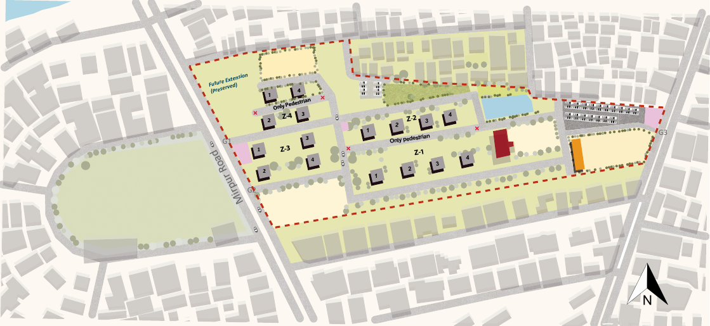

# Planning, Analysis and Design for the Reconstruction of the Green Road Government Staff Quarter, Dhanmondi, Dhaka

CE 404 Capstone Project, Department of Civil Engineering, BUET.
Group 02, Section B1.

A 12.23-acre Public Works Department staff quarter in Dhanmondi, redeveloped.
Twenty-seven old five- and six-storey blocks come down and sixteen B+G+12
blocks go up in their place, arranged in four zones by flat size. Capacity
rises from about 500 families to roughly 700. The new blocks are taller and
fewer, so the ground they free up goes to sports fields, gardens, a pond, a
rebuilt mosque and a community centre.

## At a glance

| | |
|---|---|
| Site | 12.23 acres, Dhanmondi, Dhaka |
| Proposal | 16 blocks, basement plus ground plus 12 floors, 4 flats per floor |
| Flat sizes | 1500, 1200, 1000 and 800 sft, one zone each |
| Capacity | about 500 families now, about 700 proposed |
| Structural system | Beam-supported slab on a 41 in mat, IMRF with ordinary RC shear wall |
| Codes | BNBC 2020 and ACI 318, wind cross-checked to ASCE 7-05 |
| Cost | about 510 crore BDT, or 3,225 BDT per sft |
| Programme | 2.2 years |
| FIRR and EIRR | 8.2% and 13.8% |

## Scope of work

**Survey and investigation.** Total station topographic survey, soil report
interpretation (stiff clay over dense sand, uniform to 18 m), traffic counts
at three gates worked up into ADT flow curves, and a questionnaire survey of
100 families.

**Master planning.** Four residential zones with 70 ft between blocks and
5.4 lakh sft of total plan area, basement and surface parking, a mosque for
3,000 and a community centre for 1,050.

**Alternative analysis.** Two complete schemes were designed and costed:
beam-supported slab on a mat, and flat plate on driven piles. The pile scheme
was taken all the way to final design (15 in by 30 ft piles, Qna of 150.4 kip,
1 to 8 piles per column, settlement of 16.8 mm against a 75 mm limit) before
it was rejected on cost and seismic performance.

**Structural analysis.** ETABS 20 model with 31 load combinations, Seismic
Zone 2, SDC C, period 1.37 s. Partition loads were worked out panel by panel
rather than assumed. Dead, live, partition, floor finish, seismic and wind
loads were all validated by hand, with a maximum error of 2.6%. Serviceability
covers beam and slab deflection, wind sway and drift, earthquake drift and
torsional irregularity.

**Member design.** Beams, columns with IMRF tie requirements, two-way slab by
the strip method, the 41 in mat, shear walls, the basement retaining wall
(at-rest pressure checked against Mononobe-Okabe) and the staircase.

**Water supply and tanks.** Demand to BNBC 2020 by zone, firefighting storage
and hydrant demand, then the underground reservoir, overhead tank and septic
tank designed as reinforced concrete structures: cover and base slabs, walls
solved by moment distribution, and a cracking check on the base slab.

**Plumbing and drainage.** Down-feed supply in three pressure zones. Pipe
sizing done on fixture units over two trials, the second including fitting
equivalent lengths. Riser and 17 HP pump design, separate soil and waste
stacks with their own vents, and a two-chamber septic tank.

**Environmental and social.** EIA baseline, impacts and mitigation set out by
construction stage, and a resettlement plan.

**Cost and delivery.** Bill of quantities across 24 work items at PWD rates, a
nine-part tender document, a Gantt programme, and financial and economic
analysis over a 50-year life with sensitivity cases.

## Tools

ETABS 20, AutoCAD, MS Project, MS Excel

## What's in here

- `figures/master-plan.png` and `drawings/master-plan.pdf`: the site master
  plan, showing the four zones, the three gates and the preserved future
  extension

The floor plans, structural detailing sheets, design calculations, bill of
quantities and the full report are not posted here. Ask if you would like to
see them.

## Team

Md. Imran Hossain (1804088, team leader), Muhtamim Haque Tauhid (1804070,
deputy team leader), Shifat Hasan (1804072), Md. Jahirul Islam (1804075),
Emama Binte Rahman (1804087), Fahmida Khanam (1804090).

**Supervisors.** Dr. Tahmeed Malik Al-Hussaini, Mrs. Snigdha Afsana,
Dr. Nazrul Islam, Dr. Annesha Enam.

This was group work. The drawings and the report belong to the whole team and
to BUET, and they are posted here for reference rather than reuse.
